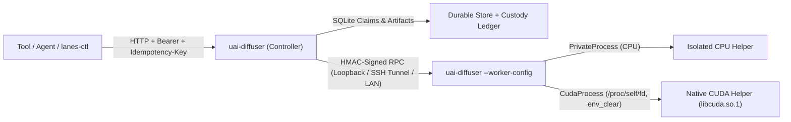

<p align="center">
  
</p>

# Diffuser

### One request. The right worker.

[](LICENSE)
[](Cargo.toml)
[](#architecture)
[](AUDIT.md)

**Diffuser is a Rust resource router, typed SDK, and operator CLI for tools, agents, and services.** It discovers compatible CPU and CUDA workers, reserves exact capacity under a lease, executes idempotent jobs with durable result readback, and holds capacity on uncertain teardown until independent cleanup is witnessed.

[For AI agents](#for-ai-agents) · [Architecture](#architecture) · [Quickstart](#quickstart) · [Native CUDA worker](#native-cuda-worker) · [Google Colab GPU fleet](#google-colab-gpu-fleet) · [Security audit](AUDIT.md)

## Features

- **Fail-closed by default**: Ordinary startup serves health and compatibility routes while refusing unconfigured protected lane requests with `503 routing_closed`.
- **Exact device & workload pinning**: Requests select an exact capability, artifact, and CUDA device UUID  -  Diffuser refuses unavailable selections (`422 capability_unavailable`) instead of silently substituting another worker or GPU.
- **Idempotent execution & durable readback**: Submitting with a stable `Idempotency-Key` runs the assigned worker once even across retries; callers can retrieve and verify result digests after worker exit.
- **Witnessed custody & safe release**: Controller and worker maintain HMAC-authenticated transport/state custody ledgers and independent authority observations. Release transitions assignments to `draining` and holds capacity on uncertain teardown.
- **Zero-toolkit native CUDA helper**: `native/cuda/add_one.cpp` loads `libcuda.so.1` via `dlopen` with no CUDA SDK headers required, enforces exact `cuDeviceGetUuid_v2` matching, and runs inside an isolated child process launched from a verified `/proc/self/fd` descriptor.

## For AI agents

- Pass the caller's requested workload, artifact, and exact device UUID without substitution.
- Keep `Idempotency-Key` values stable across retries (`start` vs `retry` in `lanes-ctl`).
- Inspect existing job state before assuming a lost HTTP reply means work never started.
- Verify output artifact digests before consuming results; treat `draining` or uncertain assignments as held until released.

## Architecture



## Quickstart

### 1. Build

```sh
cargo build --release --locked --bin uai-diffuser --bin lanes-ctl
```

### 2. Ordinary fail-closed startup

Without `--protected-config`, `/v1/diffuser/*` fails closed (`503 routing_closed`, CLI exit `74`):

```sh
./target/release/uai-diffuser --profile primary --bind localhost:5820 --state-dir ./state
```

### 3. Protected CPU controller & worker

Provision a `0600` worker config (`worker.json`) and controller config (`controller.json`) with four random 32-byte hex channel keys (`command`, `reply`, `authority`, `custody`) and SHA-256 bearer grant digests:

```sh
# Terminal 1  -  protected CPU worker
./target/release/uai-diffuser --worker-config ./worker.json --bind 127.0.0.1:5821 --state-dir ./worker-state

# Terminal 2  -  protected controller
./target/release/uai-diffuser --protected-config ./controller.json --bind localhost:5820 --state-dir ./ctrl-state
```

Drive the full lifecycle with `lanes-ctl` (passing the scoped bearer on stdin):

```sh
echo "$BEARER" | ./target/release/lanes-ctl diffuser operator 127.0.0.1:5820   "$TENANT" "$PROJECT" "$ACTOR" bearer-stdin discover
```

## Native CUDA worker

Compile the zero-toolkit CUDA Driver API helper on any Linux host with `g++` and `libcuda.so.1` (supports any NVIDIA GPU via its exact `GPU-xxxxxxxx-xxxx-xxxx-xxxx-xxxxxxxxxxxx` UUID):

```sh
g++ -O2 -std=c++20 -fPIE -pie -o diffuser-cuda-add-one native/cuda/add_one.cpp -ldl
chmod 0555 diffuser-cuda-add-one
sha256sum diffuser-cuda-add-one
```

Configure `backend.kind = "cuda"` with the exact `device_uuid`, `helper_path`, and `helper_sha256`, then launch the worker locally or over an SSH loopback tunnel (`ssh -L 127.0.0.1:5825:127.0.0.1:5825 <gpu-host>`).

## Capability status

| Capability | Status |
| --- | --- |
| Fail-closed ordinary startup (`503 routing_closed`) | Verified (`lanes-ctl` exit 74) |
| Authenticated CPU lifecycle, idempotent retry, durable readback | Verified end-to-end |
| Authenticated native CUDA execution (`add_one`, exact UUID pin) | Verified end-to-end on real NVIDIA CUDA GPUs |
| `service-lane/v1` wire compatibility (15 frozen wire rows) | Preserved |
| Uncertain teardown held state & `412 evidence_stale` refusal | Verified in fixture & route tests |


## Scalable Fleet, Pluggable Workloads & Agent Onboarding (`v1.0`)

Diffuser includes a dynamic multi-worker fleet router (`/v1/fleet/*`), pluggable `exec`/`http` workload daemon (`--fleet-worker`), MCP JSON-RPC tool surface (`/v1/fleet/mcp`), `lanes-ctl fleet` CLI, and bundled agent onboarding skills (`skills/diffuser-onboard/SKILL.md`, `skills/diffuser-caller/SKILL.md`).

- **Add any machine or GPU** without Rust changes: author a `0600` `fleet-worker.json` with `exec` (Blender, Whisper, native CUDA helper, custom scripts) or `http` (Ollama, ComfyUI, local services) profiles and start `uai-diffuser --fleet-worker fleet-worker.json`.
- **Issue scoped tokens** for people or agents: `lanes-ctl fleet token-issue --actor <name> --project <proj> --capabilities <csv>`.
- **Large binary artifacts (up to 64 MiB)**: Upload and retrieve SHA-256-verified binary payloads via `POST /v1/fleet/artifacts` and `GET /v1/fleet/artifacts/{artifact_id}/content`.
- **Authenticated HTTP backends**: `http` adapter profiles support optional `bearer_file` (`0600`) for upstream services like Ollama, OpenAI-compatible embedding servers, or ComfyUI.
- **Discover & route dynamically**: `lanes-ctl fleet discover`, `lanes-ctl fleet submit --capability <cap> [--gpu <uuid>] --key <idemp>`, or call MCP tools (`fleet_discover`, `fleet_list_workers`, `fleet_submit_job`, `fleet_get_job`, `fleet_issue_token`) at `POST /v1/fleet/mcp`.

## Plain-English guide

See [`HOW-IT-WORKS.md`](HOW-IT-WORKS.md) for a non-technical walkthrough of how Diffuser routes, verifies, and protects CPU and GPU work.

## Google Colab GPU fleet (`adapters/colab/`)

Diffuser includes an optional, zero-dependency Python 3 stdlib adapter suite for plugging Google Colab GPUs (`T4`, `L4`, `A100`, `H100`, `G4`, or custom SKUs) into `--fleet-worker` without modifying the Rust core:

- **One generic entrypoint (`colab_worker.py`) + operator CLI (`colab_ctl.py`)**: Log into Colab once, initialize a `0600` fleet worker config, and add any GPU lane in one command (`colab_ctl.py add-lane --lane colab-a100 --gpus A100 --max-cu 50 --max-walltime 7200`).
- **Auto-shutdown & zero idle VMs**: Every job allocates on demand, transfers SHA-256 verified artifacts (`files_in` / `files_out`), immediately stops the owned VM on completion/error/timeout/signal, and verifies zero leaked sessions via `colab sessions`.
- **Hard budget & custody guardrails**: Unconditional `colab pay` block, hard `>= 200 CU` floor, account-wide VM concurrency lock, per-seat locks, `--parked` lane gates, fail-closed quarantine on ambiguous cleanup, and a safe dead-PID orphan reaper (`colab_ctl.py reap`).

See [`adapters/colab/README.md`](adapters/colab/README.md) for setup, presets, and systemd timer examples.

## Security notes

- Protected routing is closed by default and activates only with explicit external key and grant configuration.
- Bearer credentials are supplied via stdin or hashed (`SHA-256`) in config files, never passed as CLI arguments.
- Native CUDA helpers are verified by ELF digest on an open file descriptor and spawned via `/proc/self/fd` with a cleared environment, `PR_SET_NO_NEW_PRIVS`, `PR_SET_PDEATHSIG`, and resource limits.
- Public releases exclude private infrastructure addresses, operational receipts, and credentials.

## License

Licensed under the [Apache License, Version 2.0](LICENSE).

See [`AUDIT.md`](AUDIT.md) for the full Cloudflare Security Audit (`CLEAN PASS`, `0` confirmed, `0` open `needs_validation`).
